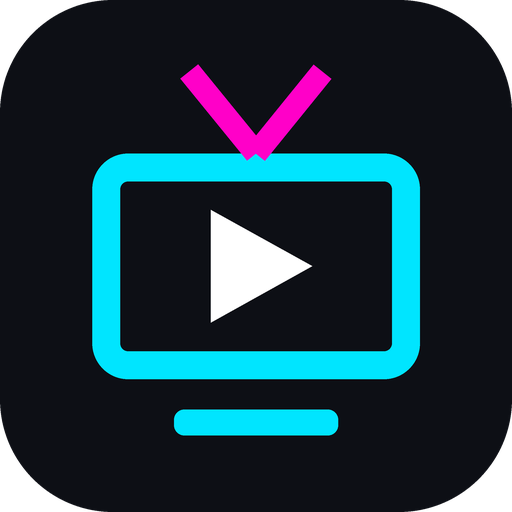

# My Live TV (2-link app)

Ek simple Android app jisme do websites do tabs mein khulti hain:

| Tab | Link |
|---|---|
| **Live TV Hub** | https://allinonelivetv.pages.dev/ |
| **StreamFlex TV** | https://streamflexsmm.in/Game/ |



## Android par install kaise karein

1. Is folder ki **`MyLiveTV.apk`** file phone mein download karein (GitHub par file kholkar "Download raw file" dabaayein).
2. File manager ya Downloads se `MyLiveTV.apk` par tap karein.
3. "Install unknown apps" ki permission maange to us app (Chrome / Files) ke liye **Allow** karein.
4. **Install** dabaayein. Play Protect warning aaye to "More details → Install anyway" chunein (app Play Store se nahi hai, isliye ye warning aati hai).

Requirement: Android 5.0 ya usse naya.

## App ke features (v3.0)

**Home tab (naya)**
- Dono links ke saare channels ek jagah: JioTV+ aur SonyLiv (Live TV Hub se), aur StreamFlex. Lagbhag 2,000+ channels.
- **Categories:** Sports, News, Movies, Entertainment, Music, Kids, Devotional, Infotainment, Business, Regional. Category chuniye, to dono sites ke us category ke channels aa jaayenge.
- **Source filter:** sirf JioTV+, sirf SonyLiv ya sirf StreamFlex ke channels.
- **Search:** naam se channel dhoondhein.
- **Recommended for you:** jo aap dekhte hain uski category ke hisaab se channels suggest hote hain. Shuru mein popular channels dikhte hain.
- **Continue Watching:** haal mein dekhe gaye channels.
- **Live Sports & Matches:** SonyLiv Events, FanCode aur Allinone Sports ke shortcuts.
- Channel par tap karte hi uska player seedha app ke andar khulta hai.

**Ad-blocker**
- Pop-up / pop-under ad networks (jinki wajah se Chrome khul jaata tha) aur Google ads block hote hain.
- `intent://` aur app-redirect wale ad links block hote hain, isliye ab Chrome nahi khulega.
- Bina tap ke khulne wali nayi windows band; tap karke khulne wale links sirf jaane-pehchane content domains par chalte hain.

**Baaki**
- "Live TV Hub" aur "StreamFlex TV" tabs pehle jaise poori website dikhate hain (ab ad-block ke saath).
- Video fullscreen karne par phone apne aap landscape ho jaata hai aur screen on rehti hai.
- Back button: fullscreen band → pichla page → player band → Home.
- Home par ↻ dabane se channel list dobara laayi jaati hai. List cache hoti hai, isliye agli baar turant khulti hai.

## Android TV par

App Android TV par bhi chalti hai aur TV ke launcher mein banner ke saath dikhti hai.

**Remote kaise chalayein**
- **↑ ↓ ← →**: channels, buttons aur tabs ke beech ghoomein. Jo chuna hua hai uske chaaron taraf neela border dikhta hai.
- **OK / Select**: chuna hua channel ya button kholein.
- **Page ke sabse upar ↑ dabaayein**: upar wale tabs (Home, Live TV Hub, StreamFlex TV) par pahunch jaayenge. Wahan se **↓** dabaane par wapas page par.
- **Back**: fullscreen band → pichla page → player band → Home.
- **Play/Pause button** (ya fullscreen mein OK): video roko ya chalaao.
- Website par koi pop-up box khule (jaise "Only India Stream"), to remote usi box ke andar chalta hai.

TV par tabs neeche ki jagah **upar** dikhte hain, taaki remote se aasaani se pahunch sakein.

## iPhone (iOS) par

`.apk` iPhone par install nahi ho sakti. Bina Apple Developer account ke iPhone par apni app install karna possible nahi hai.
Sabse aasaan tareeka:

1. iPhone par **Safari** mein pehla link kholein.
2. Neeche **Share** button (⬆️ wala dabba) → **Add to Home Screen** → **Add**.
3. Doosre link ke liye bhi yahi karein.

Home screen par dono ke icon ban jaayenge aur app ki tarah khulenge.

## Khud se APK dobara build karna (developers ke liye)

Gradle ki zaroorat nahi hai. JDK aur Android SDK (`platforms;android-34`, `build-tools;36.0.0`) chahiye:

```bash
cd android
ANDROID_HOME=/path/to/android-sdk ./build.sh
# Output: android/build/MyLiveTV.apk
```

Kaun si files kya karti hain:
- `MainActivity.java`: tabs, player screen, fullscreen, pop-up/redirect rules
- `AdBlocker.java`: block kiye gaye ad domains ki list
- `CatalogLoader.java`: channel lists chupke se (hidden WebView mein) load karta hai
- `assets/extract.js`: har site se channel ka naam, category, logo aur player link padhta hai
- `assets/home.html`: Home screen (categories, recommendations, search)
- `assets/tvnav.js`: TV remote (D-pad) navigation, har page par lagti hai
App ka naam `android/res/values/strings.xml` mein hai.

> Note: `build.sh` pehli baar `~/.android/mylivetv.keystore` banata hai. Kisi doosre computer par build ki gayi APK alag key se sign hogi, isliye update se pehle purani app uninstall karni padegi.
